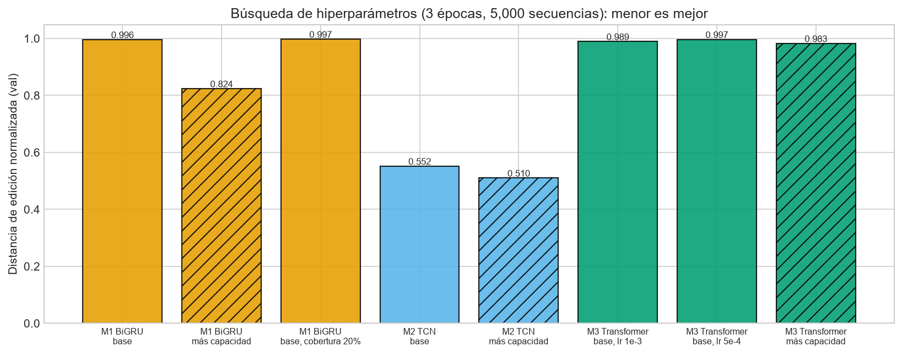
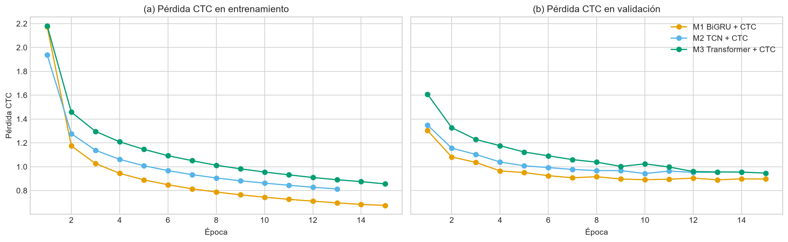
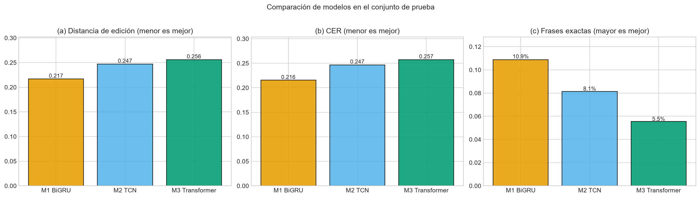
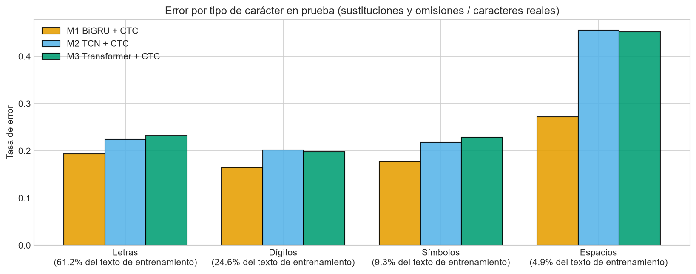
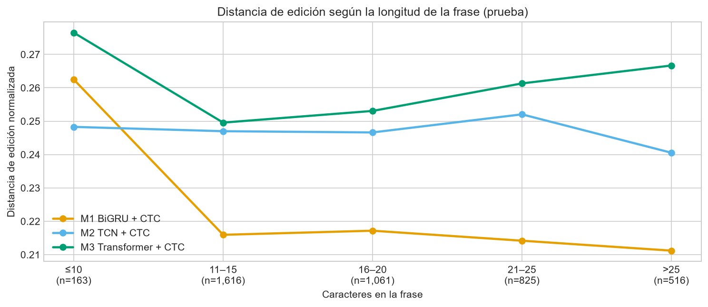
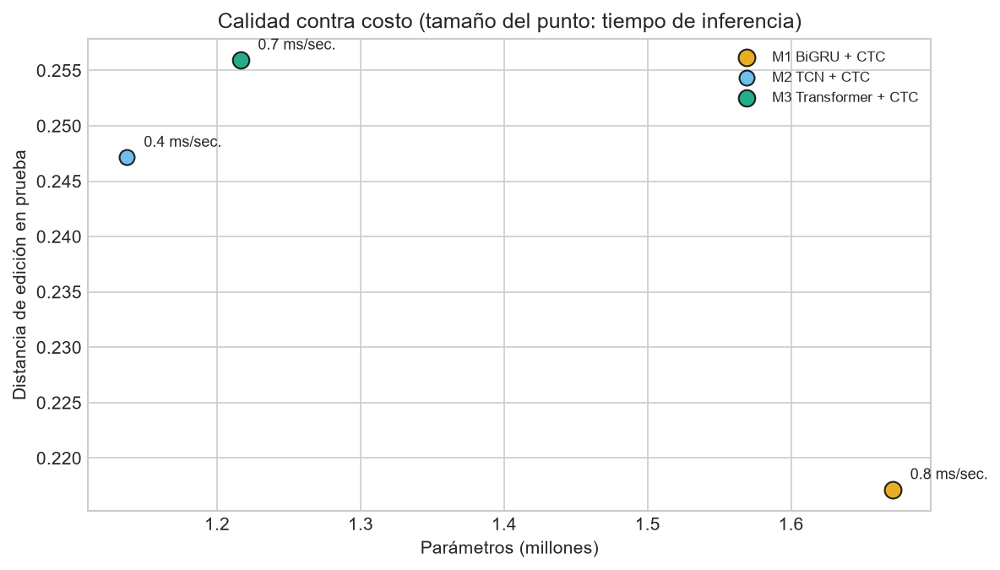

# Informe final: modelos, resultados y conclusiones

Reconocimiento de *fingerspelling* de ASL a partir de landmarks de MediaPipe
CC3084 Data Science, Proyecto 2: Resultados. Reto 15, *Google – American Sign Language Fingerspelling Recognition*.

> Este archivo contiene la metodología de modelado (selección de algoritmos, ajuste de hiperparámetros y evaluación), los resultados de los modelos y las conclusiones. Continúa a `03_informe_datos.md`. Las cifras provienen de `notebooks/Proyecto2_Resultados_Master.ipynb` (Partes II y III), ejecutado sobre el corpus completo en Kaggle; las figuras están en `reports/figures/`.

---

## 4. Metodología: modelos

### 4.6 Selección de los algoritmos

La revisión bibliográfica y el análisis exploratorio llevan a la misma formulación: el problema es de **reconocimiento de secuencias**, no de clasificación. Cada muestra es una serie de unos 160 cuadros de landmarks que debe transcribirse a una frase de longitud variable, y los datos no indican en qué cuadro empieza cada letra. Por eso los tres modelos comparten la salida y la función de pérdida. En cada cuadro emiten una distribución sobre los 59 caracteres del vocabulario oficial más el símbolo *blank*, y se entrenan con CTC (Graves et al., 2006). Lo único que cambia entre ellos es el codificador temporal, que es justo lo que la literatura discute para este tipo de problema:

| Modelo | Codificador | Justificación |
|---|---|---|
| **M1. BiGRU + CTC** | Dos capas GRU bidireccionales | Las redes recurrentes bidireccionales con CTC son la línea base clásica del reconocimiento de voz de extremo a extremo (Graves et al., 2013) y de *fingerspelling* en video (Shi et al., 2018). La GRU (Cho et al., 2014) tiene menos parámetros que la LSTM (Hochreiter y Schmidhuber, 1997). La bidireccionalidad (Schuster y Paliwal, 1997) permite que cada cuadro vea la letra anterior y la siguiente, lo que conviene a la coarticulación observada en el EDA. |
| **M2. TCN + CTC** | Convoluciones temporales dilatadas con conexiones residuales | Lea et al. (2017) y Bai et al. (2018) muestran que las convoluciones temporales igualan a las recurrentes en tareas de secuencias, con cálculo paralelo. El EDA mostró que la información está en transiciones locales entre configuraciones de mano, que una ventana convolucional captura directamente. |
| **M3. Transformer + CTC** | Encoder Transformer con codificación posicional sinusoidal | La autoatención (Vaswani et al., 2017) relaciona cualquier par de cuadros. Es la base de los Sign Language Transformers (Camgoz et al., 2020) y de las arquitecturas Conformer y Squeezeformer (Gulati et al., 2020; Kim et al., 2022) que dominaron la competencia. |

Se descartaron explícitamente dos alternativas:
- **Clasificadores de una letra por cuadro o por ventana** (por ejemplo, *random forest* o SVM sobre características agregadas): requieren saber dónde está cada letra, información que el conjunto de datos no tiene.
- **Modelos *Seq2Seq* con decodificador autoregresivo**: son más costosos de entrenar y de ejecutar en la aplicación, y no resuelven una limitación que CTC tenga en este problema, porque el texto sigue el mismo orden que el deletreo.

### 4.7 Configuración común

Para que la comparación aísle el efecto de la arquitectura, los tres modelos usan:

- **Las mismas entradas:** las 80 características por cuadro de la sección 4.3, y solo los cuadros que la máscara marca como válidos.
- **La misma partición por participante:** `train` actualiza los pesos, `val` elige hiperparámetros y checkpoints, y `test` se usa una sola vez al final.
- **El mismo entrenamiento:** optimizador AdamW, recorte del gradiente a norma 1, lotes de 32 secuencias con relleno dinámico y semilla 42.
- **La misma decodificación:** voraz, es decir, el símbolo más probable de cada cuadro seguido de la función *B* de CTC.
- **El mismo filtro:** se excluyen las secuencias que no cumplen la longitud mínima de CTC, el 3.8% del corpus.

### 4.8 Ajuste de hiperparámetros

El presupuesto de GPU disponible (Kaggle, una NVIDIA T4) no permite una búsqueda exhaustiva sobre 54,000 secuencias. Se usó una **búsqueda reducida y documentada**: cada configuración se entrenó 3 épocas sobre 5,000 secuencias de entrenamiento y se evaluó con la distancia de edición normalizada sobre el mismo conjunto de validación (cobertura ≥ 50%). Se exploraron tres ejes:

1. **Capacidad del codificador**, en los tres modelos: una versión base y una más grande (más unidades o canales y más capas).
2. **Tasa de aprendizaje** en M3 (10⁻³ frente a 5·10⁻⁴). Los Transformers son más sensibles a ella que las redes recurrentes.
3. **Umbral de cobertura** en M1 (20% frente a 50%). Esta decisión quedó pendiente en la preparación de datos: con 20% se entrena con el 90% del corpus, pero con secuencias más incompletas.

La configuración con menor distancia de edición en validación de cada arquitectura se entrenó luego con todos los datos. El entrenamiento final se detiene en la primera de tres condiciones: 15 épocas, 3 épocas seguidas sin mejorar la pérdida de validación (*early stopping*) o 30 minutos de GPU por modelo. Siempre se conserva el checkpoint con menor pérdida de validación.

### 4.9 Evaluación

Cada modelo final se evaluó una vez sobre `test`, con 10 participantes que no intervinieron ni en el entrenamiento ni en la selección de hiperparámetros. Se reportan:

- **Distancia de edición normalizada** (métrica principal; sección 3.6).
- **CER**, y el puntaje de la competencia `1 − CER`.
- **Proporción de frases exactas**.
- **Error por tipo de carácter** (letras, dígitos, símbolos y espacios), para contrastar con el desbalance del vocabulario hallado en el EDA.
- **Error según la longitud de la frase**.
- **Costo:** número de parámetros, tiempo de inferencia y tiempo de entrenamiento.

---

## 5. Resultados de los modelos

Todos los modelos se entrenaron en Kaggle con una GPU NVIDIA T4, ejecutando el notebook maestro de principio a fin, y se evaluaron sobre 4,181 frases de prueba de 10 participantes no vistos.

### 5.8 Ajuste de hiperparámetros

**Tabla 5.1.** Búsqueda reducida: 3 épocas sobre 5,000 secuencias, evaluada en el mismo conjunto de validación (Figura 5).

| Modelo | Configuración | Parámetros | Distancia de edición (val) |
|---|---|---|---|
| M1 | Base (128 unidades, 2 capas) | 473,405 | 0.996 |
| M1 | **Más capacidad (192 unidades, 3 capas)** | 1,670,845 | **0.824** |
| M1 | Base, cobertura ≥ 20% | 473,405 | 0.997 |
| M2 | Base (128 canales, 4 niveles) | 347,453 | 0.552 |
| M2 | **Más capacidad (192 canales, 6 niveles)** | 1,136,701 | **0.510** |
| M3 | Base, tasa 10⁻³ | 416,189 | 0.989 |
| M3 | Base, tasa 5·10⁻⁴ | 416,189 | 0.997 |
| M3 | **Más capacidad (d = 192, 4 capas), tasa 5·10⁻⁴** | 1,216,189 | **0.983** |

La búsqueda favoreció la mayor capacidad en las tres arquitecturas. Su principal limitación es el presupuesto: con 3 épocas, M1 y M3 apenas empezaban a emitir caracteres (distancia cercana a 1), mientras que la TCN, que converge más rápido, ya llegaba a 0.51. Por eso la búsqueda sirve para elegir dentro de cada arquitectura, pero no para compararlas entre sí. La comparación de cobertura (20% contra 50%) quedó sin decidir (0.997 contra 0.996), y se mantuvo el umbral de 50% del análisis exploratorio.

### 5.9 Entrenamiento final

**Tabla 5.2.** Entrenamiento final con la configuración elegida (37,366 secuencias; Figura 6).

| | M1 BiGRU | M2 TCN | M3 Transformer |
|---|---|---|---|
| Épocas ejecutadas (mejor) | 15 (13) | 13 (10) | 15 (15) |
| Segundos por época | 83 | 53 | 97 |
| Minutos de entrenamiento | 20.8 | 11.4 | 24.3 |
| Pérdida CTC en validación | 0.890 | 0.943 | 0.947 |

M2 se detuvo por *early stopping*: no mejoró en tres épocas seguidas. M1 llegó a su mínimo en la época 13 y se estabilizó. M3 obtuvo su mejor pérdida en la **última** época, señal de que todavía no había convergido. Ningún modelo alcanzó el límite de 30 minutos.

### 5.10 Comparación en el conjunto de prueba

**Tabla 5.3.** Resultados en prueba (Figura 7).

| Modelo | Distancia de edición | CER | 1 − CER | Frases exactas | Parámetros | ms por secuencia* |
|---|---|---|---|---|---|---|
| **M1 BiGRU + CTC** | **0.217** | **0.216** | **0.784** | **10.9%** | 1.67 M | 0.77 |
| M2 TCN + CTC | 0.247 | 0.247 | 0.753 | 8.1% | 1.14 M | **0.35** |
| M3 Transformer + CTC | 0.256 | 0.257 | 0.743 | 5.6% | 1.22 M | 0.71 |

\* Inferencia en GPU T4, por lotes de 32 secuencias.

M1 es el mejor modelo en las tres métricas de calidad. Transcribe correctamente unos 78 de cada 100 caracteres, y más de una de cada diez frases sin ningún error. El orden de los modelos es el mismo en validación (0.205, 0.232 y 0.235). Las cifras de prueba son algo peores que las de validación en todos los modelos, a pesar de que, según la preparación de datos, la validación era el conjunto con menor cobertura. Lo más probable es que la diferencia se deba a la variabilidad entre firmantes: con 9 y 10 participantes por conjunto, unos pocos firmantes pesan mucho en el promedio.

Respecto de la primera versión de M1 (128 unidades, 8 épocas y lotes de 16), que obtuvo 0.244 en validación, la configuración final mejora la distancia de edición en unos 4 puntos.

### 5.11 Análisis de errores

**Por tipo de carácter (Figura 8).** Las letras son el 61% del texto de entrenamiento y los dígitos el 25%. Aun así, las letras fallan más (19.4% en M1) que los dígitos (16.5%) y que los símbolos (17.8%; 9% del texto). La frecuencia, por sí sola, no explica el error. Los dígitos tienen configuraciones de mano muy distintas entre sí y aparecen en patrones repetitivos, como teléfonos y códigos postales. Las letras, en cambio, incluyen pares con formas parecidas que la coarticulación vuelve más ambiguos. **Los espacios son el punto más débil**: 27% de error en M1 y 45% en M2 y M3. No tienen seña propia, así que el modelo debe deducirlos de las pausas entre palabras. M1, que integra contexto en ambos sentidos de toda la frase, es el que mejor lo resuelve. Las ventanas locales de la TCN y el Transformer, sin suficiente entrenamiento, no lo logran.

**Por longitud de la frase (Figura 9).** El error de M1 es estable entre 11 y más de 25 caracteres (0.21–0.22). Solo las frases muy cortas (10 caracteres o menos; 163 casos) son algo peores (0.26), porque cada error pesa más en el promedio. CTC maneja bien las secuencias largas, como las URLs y las direcciones que forman la cola de la distribución vista en el EDA.

**Calidad contra costo (Figura 10).** M2 tiene la mitad del tiempo de inferencia y la mitad del tiempo de entrenamiento de M1, a cambio de 3 puntos de distancia de edición. En la aplicación, que corre en CPU, los tres modelos responden en milisegundos, así que la diferencia de costo no limita su uso.

**Ejemplos.** Los errores típicos son omisiones y sustituciones de caracteres sueltos, no frases inventadas. Por ejemplo, "271097 bayshore boulevard" se transcribe como "271097 bayshore borevard" (M1), y "+20-4703-88149" se transcribe perfectamente con los tres modelos. Menos del 0.1% de las frases quedan vacías.

---

## 6. Conclusiones

### 6.1 Cumplimiento de los objetivos

**Objetivo general.** Se cumplió. Se construyó un sistema que transcribe a texto secuencias de *fingerspelling* representadas como landmarks. Comprende la preparación del corpus completo, tres modelos CTC comparados en firmantes no vistos y una aplicación interactiva. Todo se reproduce desde un único notebook ejecutado en Kaggle.

1. **Preprocesamiento único y reproducible.** Se cumplió. `preprocess_sequence` aplica los siete pasos derivados del análisis exploratorio y procesó las 67,208 secuencias (190 GB) en unos 9 minutos, reduciéndolas a 1.6 GB. Se verificó, en local y en Kaggle, que una secuencia cruda produce exactamente las mismas características al entrenar y en la aplicación.
2. **Partición por firmante.** Se cumplió. Los 94 participantes se repartieron en 75, 9 y 10, sin ningún firmante compartido entre conjuntos (el código lo comprueba antes de entrenar). Las métricas de prueba corresponden, por lo tanto, a personas que ningún modelo vio.
3. **Tres modelos CTC sobre el corpus completo.** Se cumplió. M1 (BiGRU), M2 (TCN) y M3 (Transformer) se ajustaron con una búsqueda de hiperparámetros y se entrenaron con 37,366 secuencias de los 68 archivos en una GPU T4, en 11 a 24 minutos cada uno.
4. **Comparación de los modelos.** Se cumplió. **M1 es el mejor modelo**: en prueba alcanza una distancia de edición de 0.217, un CER de 0.216 (puntaje de la competencia 0.784) y un 10.9% de frases exactas. **M2 es la alternativa eficiente**: la mitad del tiempo de entrenamiento y de inferencia, con 3 puntos más de error. **M3 obtuvo el peor resultado** con este presupuesto, pero no había convergido.
5. **Relación con el análisis exploratorio.** Se cumplió. El desbalance de caracteres no basta para predecir dónde fallan los modelos: las letras, el tipo más frecuente, fallan más que dígitos y símbolos, y el principal problema son los espacios, que no tienen seña propia. La decisión del EDA de no rellenar con ceros, sino interpolar huecos cortos y enmascarar el resto, permitió entrenar con el 71% del corpus. La partición por firmante, motivada por el 38% de varianza que explica el firmante, evitó una evaluación optimista.
6. **Aplicación.** Se cumplió. La aplicación recibe secuencias crudas en CSV o Parquet, las preprocesa sin intervención del usuario y muestra la transcripción de uno, varios o los tres modelos, junto con su rendimiento en prueba en gráficas interactivas que se pueden ocultar.

### 6.2 Efectividad de los algoritmos

La formulación como reconocimiento de secuencias con CTC fue la adecuada. Permitió entrenar sin saber dónde empieza cada letra, el error no crece con la longitud de la frase y la restricción de longitud mínima solo excluyó el 3.8% del corpus. Con el presupuesto disponible, la recurrencia bidireccional aprovechó mejor un conjunto de este tamaño que la atención, y es el modelo recomendado para la aplicación. Una distancia de edición de 0.217 significa que, en promedio, uno de cada cinco caracteres requiere corrección. Es útil para demostrar el enfoque, pero todavía insuficiente para un uso cotidiano sin revisión.

### 6.3 Limitaciones y trabajo futuro

El presupuesto de GPU obligó a una búsqueda de hiperparámetros reducida, que no permitió decidir el umbral de cobertura ni comparar las arquitecturas en igualdad de convergencia. Tampoco se usaron aumento de datos, decodificación con un modelo de lenguaje ni los datos suplementarios de la competencia. Son las tres mejoras con más potencial, en ese orden. M3, en particular, debería reentrenarse con más épocas y con un bloque convolucional (Conformer), como en las soluciones ganadoras de la competencia.
