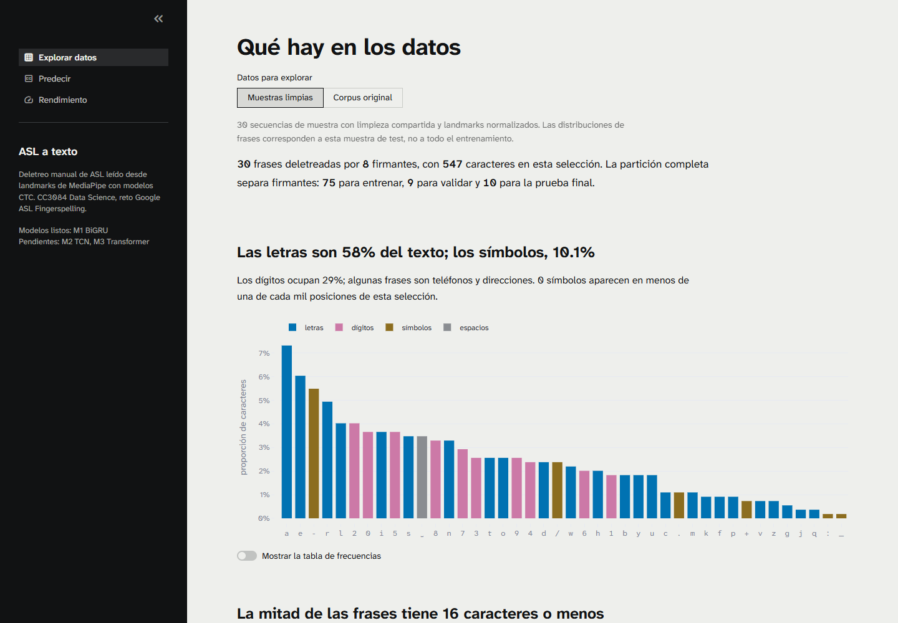
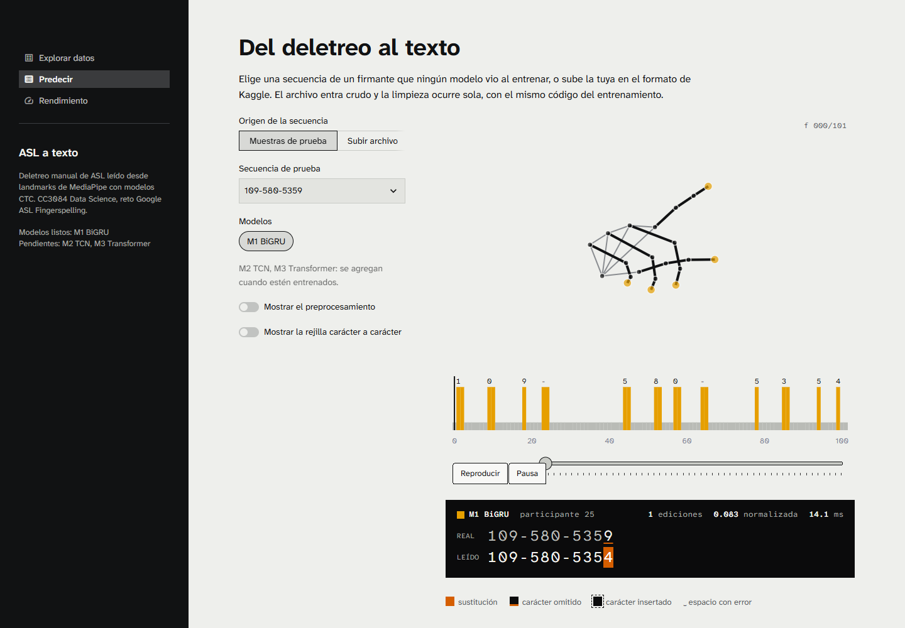
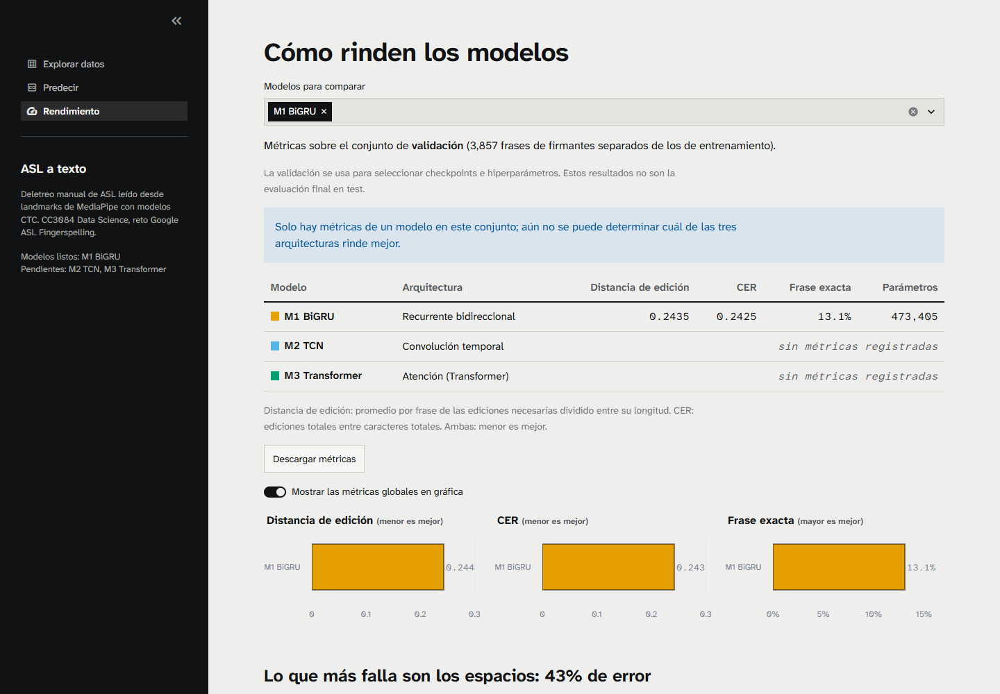
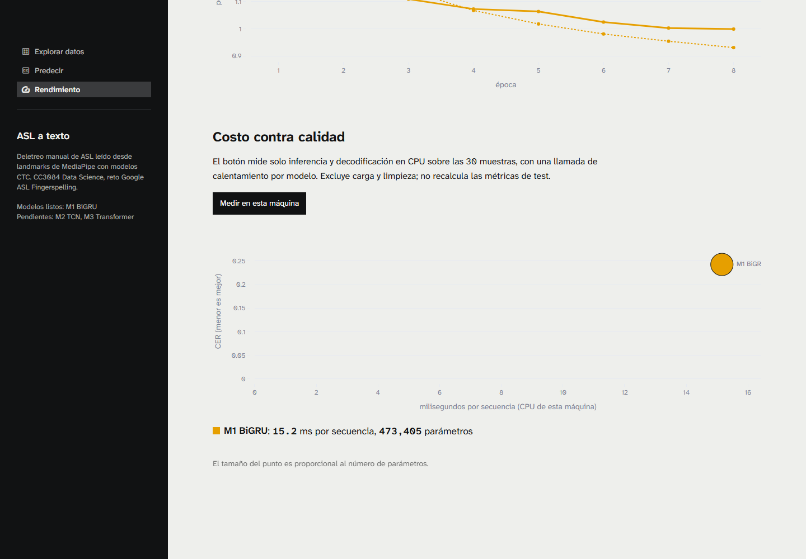

# Aplicación de reconocimiento de deletreo manual

## Propósito y alcance

La aplicación permite explorar los datos y transcribir una secuencia de landmarks de MediaPipe a texto. La entrada conserva el formato crudo de Kaggle; la limpieza se ejecuta automáticamente con `src/preprocessing.py`, el mismo módulo utilizado para preparar los datos de entrenamiento. El sistema reconoce secuencias de deletreo de ASL. No traduce lenguaje de señas completo ni extrae landmarks desde videos o una cámara.

La navegación contiene tres páginas: **Explorar datos**, **Predecir** y **Rendimiento**. El orden de la demostración comienza con una predicción para mostrar el resultado concreto, continúa con los datos que la explican y termina con los errores y el costo computacional.

## Tecnologías y organización

Se utilizó **Streamlit** para formularios, carga de archivos, navegación y controles de visibilidad. Su integración con Python permite reutilizar directamente los contratos de preprocesamiento y modelado. **Plotly** aporta gráficas con hover, leyendas, controles de animación y selección de frames. **Pandas**, **NumPy** y **PyArrow** permiten leer CSV y Parquet y transformar coordenadas. **PyTorch** carga los checkpoints en CPU y ejecuta el modelo sin conversión adicional de sus pesos.

Las vistas se encuentran en `app/views/`. La carga de datos, inferencia, gráficas y comparación de caracteres se separan en `app/lib/`. Los datos y modelos se resuelven con rutas relativas a la ubicación del repositorio. La configuración visual está en `.streamlit/config.toml`; las fuentes están incluidas en `app/static/fonts/`. Los recursos necesarios para la demostración son locales y no requieren acceso a Kaggle.

Los modelos cargados se conservan en caché de recursos. Los metadatos, muestras e historiales utilizan caché de datos. Al cambiar pesos o métricas se reinicia la aplicación para refrescar esas cachés. La primera inferencia puede ser más lenta por el calentamiento; por eso el benchmark realiza una llamada inicial por modelo antes de registrar tiempos.

## Exploración de datos limpios

La vista inicia con las **30 muestras limpias** incluidas en el repositorio. Sus distribuciones de frases corresponden a 8 firmantes de test y no se extrapolan al corpus completo. Un control separado permite consultar los metadatos originales de `data/train.csv`: 67 208 frases de 94 firmantes. La partición completa contiene 75 firmantes de entrenamiento, 9 de validación y 10 de prueba, con semilla 42.

Se muestran frecuencia y categoría de caracteres, longitud de frases y aporte por participante. Para una secuencia elegida se puede consultar presencia de mano y pose, trayectoria normalizada de la punta del índice, esqueleto animado y distancia de los 21 landmarks a la muñeca en unidades de palma. La cobertura y su resumen por mano activa se calculan después de la limpieza. Las pérdidas de tracking se distinguen de los frames válidos; un salto de trayectoria no se interpreta automáticamente como un cambio de letra.

**Figura 1.** Distribución de caracteres de las muestras limpias. El selector distingue esta vista del corpus original.

## Predicción y comparación

El usuario selecciona una muestra o carga un archivo CSV o Parquet. Si el archivo contiene varias secuencias, elige explícitamente su `sequence_id`. La entrada debe contener las 63 coordenadas de al menos una mano completa; la pose y la mano restante pueden faltar y se representan como ausentes. Si no existe `frame`, se conserva el orden de las filas y se genera un índice temporal.

El pipeline selecciona la mano activa, refleja las secuencias izquierdas, invalida picos de velocidad, recorta extremos ausentes, interpola huecos internos de hasta cinco frames y normaliza la mano y la pose. Produce **80 características por frame** y una máscara booleana. Solo los frames válidos se envían al codificador temporal. Un control opcional permite consultar el diagnóstico de los siete pasos sin exigir al usuario realizar la limpieza.

La selección de modelos admite uno, varios o todos los checkpoints disponibles. Para cada uno se muestra texto, tiempo de inferencia en CPU y, cuando hay una frase de referencia, distancia de edición y distancia normalizada. Las sustituciones, omisiones e inserciones se alinean carácter por carácter y se identifican mediante marcas y colores. Una tabla y su descarga CSV permiten conservar la comparación. La referencia ingresada no se modifica silenciosamente: espacios y mayúsculas afectan la distancia de edición.

La animación presenta la mano normalizada, la pista de emisiones CTC y el texto acumulado. La probabilidad de un token por frame no se presenta como una confianza calibrada de la frase completa. La reproducción usa frames válidos y una cadencia de visualización de 30 fps; no reconstruye la duración original de los huecos descartados.

En la muestra de referencia `109-580-5359`, M1 produce `109-580-5354`: una sustitución y distancia normalizada de 0,0833. Es un ejemplo individual y no reemplaza la evaluación agregada.

**Figura 2.** Animación y subtítulo de M1 con la frase real y la predicción alineadas.

## Rendimiento e interpretación

Las cifras se leen de `models/metrics.json`. La página ofrece selección de modelos, tabla, descarga de métricas y controles para mostrar u ocultar métricas globales, errores por categoría, relación frecuencia-error y curvas de entrenamiento. Cuando existen resultados de validación y prueba o tamaños distintos, se presentan en grupos separados. La coincidencia en split y número de secuencias permite agrupar entradas, pero debe verificarse en el notebook que compartan el mismo conjunto evaluado antes de realizar una comparación científica.

Actualmente está disponible M1 BiGRU: **3 857 secuencias de validación**, distancia de edición normalizada **0,2435**, CER **0,2425**, coincidencia exacta **13,12 %** y **473 405 parámetros**. La distancia normalizada es un promedio por frase; CER pondera los errores por el total de caracteres. La validación intervino en la selección del checkpoint, así que estas cifras no se presentan como resultados finales de test.

El error por tipo de carácter de M1 es 23,62 % en letras, 17,69 % en dígitos, 22,81 % en símbolos y 43,49 % en espacios. Esta tasa cuenta omisiones y sustituciones sobre caracteres de referencia; las inserciones se registran aparte y sí intervienen en CER. Los espacios tienen el mayor error, pero el orden de frecuencias no explica por sí solo todos los resultados: los símbolos son menos frecuentes que las letras y muestran una tasa de error algo menor. La asociación entre frecuencia y error no demuestra causalidad.

**Figura 3.** Métricas identificadas como validación. La interfaz indica que aún no hay una comparación final de las tres arquitecturas.

El botón **Medir en esta máquina** realiza una llamada de calentamiento por modelo y mide inferencia y decodificación sobre las 30 muestras. Excluye carga de pesos, lectura y preprocesamiento; no modifica las métricas guardadas ni vuelve a evaluar test. El diagrama combina CER, latencia media y parámetros. La demostración grabada registró aproximadamente **15,2 ms por secuencia** para M1; este valor depende del equipo y de su carga. Los 2,22 ms por secuencia registrados durante la evaluación por lotes provienen de otro entorno y no son directamente comparables con la inferencia individual en CPU.

**Figura 4.** Medición de eficiencia en CPU, con el promedio de latencia y el número de parámetros de M1.

## Diseño visual y accesibilidad

La interfaz utiliza una base acromática para reducir competencia visual con los resultados. El texto `#111213` sobre el fondo `#EEEFEC` tiene una relación de contraste aproximada de **16,25:1**; el texto secundario `#55585C`, **6,20:1**. Los subtítulos usan fondo `#0B0B0C` y texto `#F5F5F0`, con **17,99:1**. Estos valores se calcularon mediante luminancia relativa sRGB y se interpretan con el criterio de contraste de WCAG 2.2 (W3C, 2023).

Para identificar modelos se utiliza una paleta categórica basada en Okabe e Ito (2008): naranja para M1, azul para M2 y verde para M3. Cada modelo conserva su color entre páginas. Los nombres, contornos y marcas de error complementan el tono, de acuerdo con el principio de no depender exclusivamente del color. La magnitud de las coordenadas usa una escala secuencial azul con luminancia decreciente; la presencia anatómica utiliza una escala binaria acromática.

Las fuentes Atkinson Hyperlegible Next y Mono, desarrolladas para mejorar la diferenciación de caracteres, se incluyen localmente (Braille Institute, s. f.). La tipografía monoespaciada facilita la alineación de números y subtítulos. La justificación detallada y los códigos de color se conservan en `reports/app_paleta.md`. Estos criterios de diseño no constituyen una certificación integral de accesibilidad.

## Validación, errores y demostración

La carga rechaza archivos ilegibles, formatos ajenos a CSV o Parquet, entradas vacías, manos incompletas, coordenadas no numéricas o infinitas, frames no finitos, frames duplicados y registros sin identificador en archivos con `sequence_id`. Se limita la entrada a 10 000 frames. La ausencia total de una mano válida detiene la predicción con un mensaje comprensible; pocos frames generan una advertencia. Un fallo de inferencia se informa por modelo y permite conservar resultados de los demás.

Las pruebas cubren lectura CSV/Parquet, selección de múltiples secuencias, entradas inválidas, pose ausente, mano ausente, equivalencia entre la inferencia de la app y `src.models.predict`, renderizado de las tres vistas y controles de visibilidad. La demostración en navegador recorre predicción, exploración, rendimiento y benchmark con el checkpoint real.

La presentación está en `reports/presentacion/ASL_resultados.pptx`; el guion y las instrucciones de ensayo en `reports/guion_demo.md`. El video `reports/demo_app.mp4` permite mostrar el mismo recorrido si falla la demostración en vivo. Está grabado sin audio para acompañarlo con la explicación del expositor.

## Integración de artefactos finales

La app tiene soporte para BiGRU, TCN y Transformer mediante `src.models.load_model`. En el estado actual del repositorio solo existe un checkpoint final de M1 y su entrada de validación en `metrics.json`. Para completar la comparación de las tres arquitecturas es necesario incorporar los checkpoints finales de M2 y M3 y los resultados reales de test. No se sustituyen con predicciones simuladas. Esta dependencia afecta la comparación de resultados, aunque la navegación, la selección múltiple y el contrato de inferencia ya están implementados y probados.

## Referencias

- Braille Institute. (s. f.). *Atkinson Hyperlegible Font*. https://www.brailleinstitute.org/freefont/
- Okabe, M., & Ito, K. (2008). *Color Universal Design (CUD): How to make figures and presentations that are friendly to colorblind people*. https://jfly.uni-koeln.de/color/
- World Wide Web Consortium. (2023). *Web Content Accessibility Guidelines (WCAG) 2.2*. https://www.w3.org/TR/WCAG22/

Las referencias de esta sección son fuentes primarias de diseño y accesibilidad; complementan la bibliografía de investigación sobre modelos del informe general.
